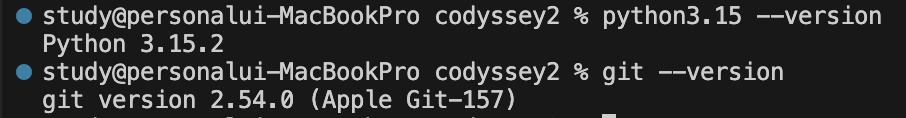
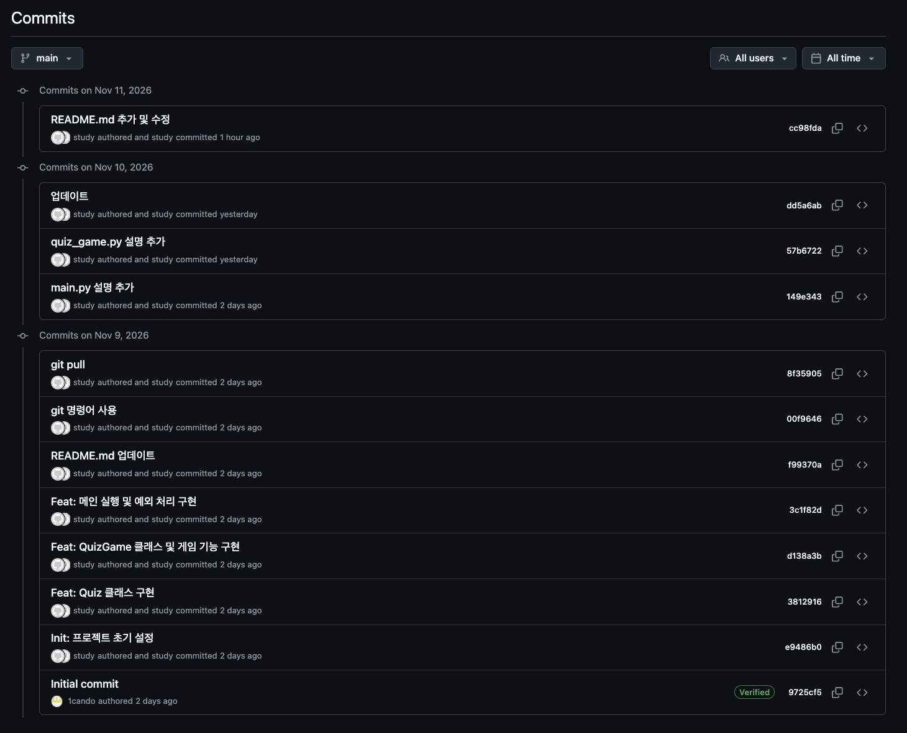
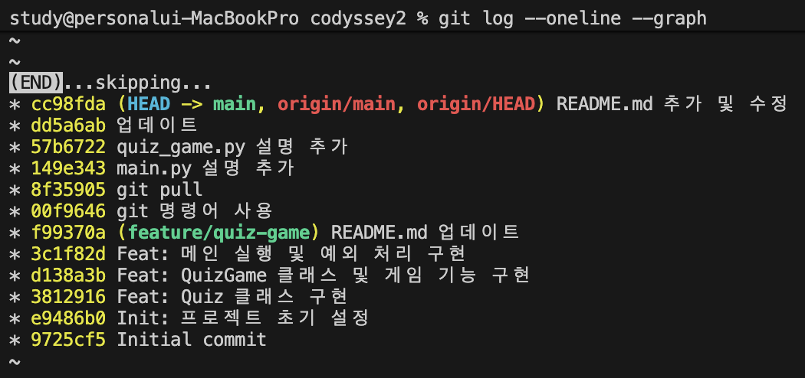
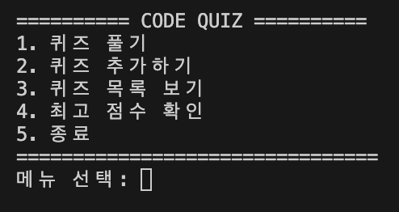
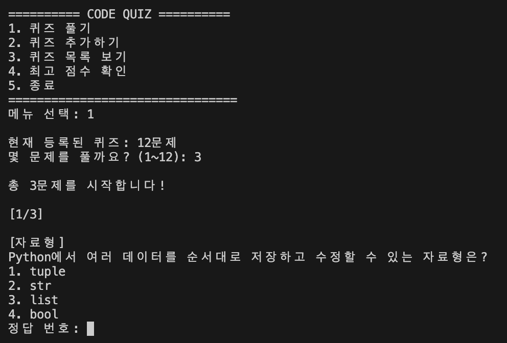
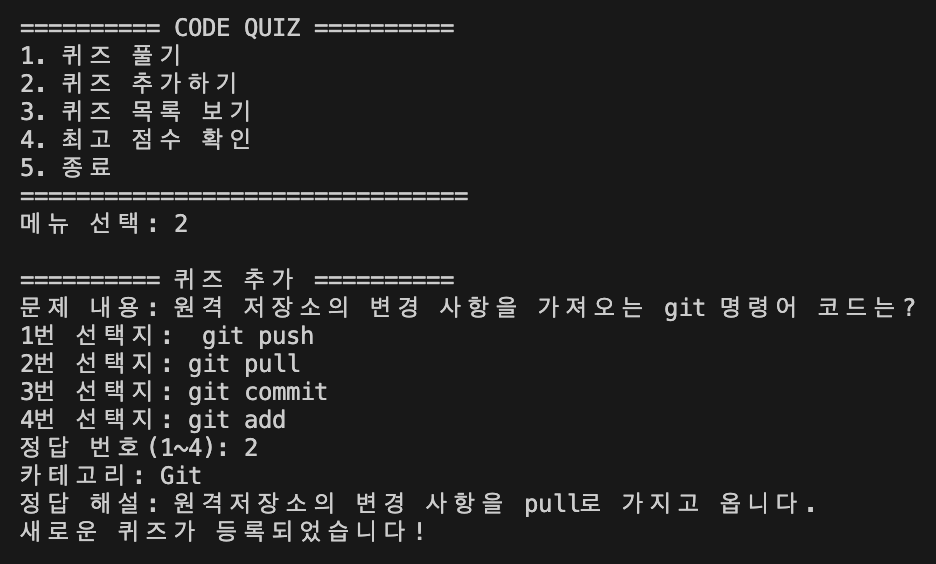
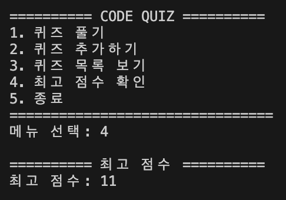

# codyssey2
# Code Quiz — Python & Git Challenge

## 1. 프로젝트 개요

**Code Quiz**는 Python과 Git의 기본 개념을 학습하고 복습할 수 있도록 제작한 콘솔 기반 퀴즈 게임입니다.

사용자는 객관식 퀴즈를 풀고 점수를 확인할 수 있으며, 새로운 문제를 직접 추가할 수도 있습니다. 퀴즈와 최고 점수는 JSON 파일에 저장되어 프로그램을 종료한 후 다시 실행해도 유지됩니다.

## 2. 퀴즈 주제 선정 이유

이번 프로젝트에서는 Python과 Git을 주제로 퀴즈 게임을 제작했습니다.

프로젝트 과제를 수행하면서 학습한 Python 문법, 클래스와 객체, 파일 입출력, 예외 처리 및 Git 명령어를 다시 복습하고 싶었습니다.

또한 과제 이후 예정된 시험에 대비하여 학습 내용을 단순히 읽는 것에서 그치지 않고, 직접 문제를 풀면서 이해도를 확인할 수 있도록 기획했습니다.

## 3. 개발 환경

| 항목 | 사용 환경 |
|---|---|
| OS | macOS |
| Language | Python 3.15.2 |
| IDE | Visual Studio Code |
| Version Control | Git / GitHub |
| Data Storage | JSON |
| Library | Python Standard Library |

```bash
% python3.15 --version
Python 3.15.2
```


**GitHub 저장소 URL**
https://github.com/1cando/codyssey2.git

## 4.Git

### 1) git 저장소 생성

```bash
# 깃 저장소 초기화
% git init

# 로컬 Git 저장소와 GitHub 원격 저장소를 연결
% git remote add origin https://github.com/[깃주소].git

# 깃 파일 생성
% touch main.py quiz.py quiz_game.py state.json .gitignore README.md

# 변경 파일 스테이징
% git add .

# 변경 사항 기록
% git commit -m "Initial commit"

# 현재 브랜치 이름을 main으로 변경
% git branch -M main

# 이후 push/pull의 기본 원격 브랜치 지정하여 GitHub에 업로드
% git push -u origin main
```

### 2) git 브랜치 생성 및 이동

```bash
# 브랜치 전환 및 생성
% git checkout -b feature/quiz-game
Switched to a new branch 'feature/quiz-game'

% git branch
* feature/quiz-game
  main
```

### 3) git 병합

```bash
% git checkout main
M       .gitignore
Switched to branch 'main'
Your branch is up to date with 'origin/main'.

% git merge feature/quiz-game 
Updating e9486b0..f99370a
Fast-forward
 README.md    | 165 ++++++++++++++++++++++++++++++++++++++++++++++++++++++++---------
 main.py      |  38 +++++++++++++++
 quiz.py      |  46 ++++++++++++++++++
 quiz_game.py | 284 ++++++++++++++++++++++++++++++++++++++++++++++++++++++++++++++++++++++++++++++++++++++++++++++++++++++++++++++++
 4 files changed, 510 insertions(+), 23 deletions(-)

 % git push origin main
Enumerating objects: 17, done.
Counting objects: 100% (15/15), done.
Delta compression using up to 15 threads
Compressing objects: 100% (12/12), done.
Writing objects: 100% (12/12), 8.82 KiB | 8.82 MiB/s, done.
Total 12 (delta 3), reused 0 (delta 0), pack-reused 0 (from 0)
remote: Resolving deltas: 100% (3/3), done.
To https://github.com/[깃주소].git
   e9486b0..f99370a  main -> main
```

### 1) git 저장소 복제

```bash
# 원격 저장소 복제
# GitHub에 있는 codyssey2 저장소를 codyssey2-copy라는 새 폴더에 복제
% git clone https://github.com/[깃주소].git codyssey2-copy
Cloning into 'codyssey2'...
remote: Enumerating objects: 3, done.
remote: Counting objects: 100% (3/3), done.
remote: Total 3 (delta 0), reused 0 (delta 0), pack-reused 0 (from 0)
Receiving objects: 100% (3/3), done.
```

### 5) git 변경사항 가져오기

```bash
# GitHub 변경 사항 가져와 통합
% git pull
remote: Enumerating objects: 7, done.
remote: Counting objects: 100% (7/7), done.
remote: Compressing objects: 100% (3/3), done.
remote: Total 4 (delta 1), reused 4 (delta 1), pack-reused 0 (from 0)
Unpacking objects: 100% (4/4), 1.59 KiB | 543.00 KiB/s, done.
From https://github.com/1cando/codyssey2
   f99370a..00f9646  main       -> origin/main
Updating f99370a..00f9646
Fast-forward
 .gitignore |  8 ++++++++
 README.md  | 95 ++++++++++++++++++++++++++++++++++++++++++++++++++++++++++++++++++++++++++++++++++-------------
```

### 5) git 기타 명령어

```bash
# 파일 변경상태 확인 
% git status
On branch main
Your branch is up to date with 'origin/main'.

Changes not staged for commit:
  (use "git add <file>..." to update what will be committed)
  (use "git restore <file>..." to discard changes in working directory)
        modified:   .gitignore
        modified:   README.md

no changes added to commit (use "git add" and/or "git commit -a")
```

### 6) git commit 현황

```bash
% git log --oneline --graph
```


## 5. 실행방법

### 1) 개발 환경
Python 3.10 이상

### 2) 프로젝트 실행
프로젝트 폴더에서 터미널을 열고 다음 명령어를 실행합니다.
```bash
% python3 main.py
```


## 6. 기능 목록

- **퀴즈 풀기**
  - 등록된 퀴즈 중 풀고 싶은 문제 수를 선택하여 랜덤 출제할 수 있습니다.
  - 정답 여부를 확인할 수 있습니다.
  - 정답 해설을 확인할 수 있습니다.

- **퀴즈 추가**
  - 새로운 문제와 선택지를 등록할 수 있습니다.
  - 정답 번호와 카테고리, 해설을 설정할 수 있습니다.

- **퀴즈 목록 확인**
  - 등록된 퀴즈를 확인할 수 있습니다.

- **점수 관리**
  - 현재 점수를 확인할 수 있습니다.
  - 최고 점수를 기록하고 저장합니다.

- **데이터 저장 및 불러오기**
  - 퀴즈와 최고 점수를 JSON 파일에 저장합니다.
  - 프로그램을 다시 실행해도 기존 데이터를 불러옵니다.

- **문제별 카테고리 구분**
  - 문제별로 카테고리를 구분합니다.


## 7. 파일 구조

```text
code-quiz/
├── main.py
├── quiz.py
├── quiz_game.py
├── state.json
├── state.json.bak
├── README.md
├── .gitignore
└── screenshots/
    ├── add_quiz.png
    ├── develop_env.png
    ├── git_commit.png
    ├── git_log_oneline_graph.png
    ├── menu.png
    ├── play.png
    ├── add_quiz.png
    └── score.png
```

| 파일 | 설명 |
|---|---|
| `main.py` | 프로그램 실행 및 전체 흐름 관리 |
| `quiz.py` | 퀴즈 한 문제를 표현하는 Quiz 클래스 |
| `quiz_game.py` | 퀴즈 진행, 문제 추가, 점수 관리 등을 담당하는 QuizGame 클래스 |
| `state.json` | 퀴즈 데이터와 최고 점수 저장 |
| `README.md` | 프로젝트 설명 |
| `.gitignore` | Git 추적 제외 파일 설정 |
| `screenshots/` | 프로그램 실행 화면 캡처 저장 |


## 8. 데이터 파일 설명 (Data File)

우리 프로그램은 퀴즈와 최고 점수를 state.json이라는 파일에 저장하고 있다.

### 1) 경로 (Path)
state.json 파일의 저장 위치

```bash
self.data_file = Path(__file__).resolve().parent / "state.json"
```
이 코드는 quiz_game.py가 있는 폴더에 state.json을 저장하거나 읽겠다는 의미

### 2) 역할 (Role)
이 파일이 어떤 데이터를 보관하는지 설명
- 등록된 퀴즈 목록
- 각 퀴즈의 문제, 선택지, 정답, 카테고리, 해설
- 최고 점수


### 3) 스키마 (Schema)
데이터가 어떤 항목과 구조로 구성되어 있는지 보여주는 설계도

**state.json의 구조**
```bash
{
    "quizzes": [
        {
            "question": "Python에서 변수의 역할은?",
            "choices": [
                "데이터를 저장하고 참조한다",
                "반복문을 실행한다",
                "파일을 삭제한다",
                "프로그램을 종료한다"
            ],
            "answer": 1,
            "category": "Python 기초",
            "explanation": "변수는 값을 저장하고 이름으로 참조할 수 있게 해줍니다."
        },
    ],
    "best_score": 11
}
```
**state.json의 스키마**
| 항목 | 자료형 | 설명 |
| --- | --- | --- |
| quizzes |	List | 퀴즈 목록 |
| question | String | 문제 내용 |
| choices |	List | 선택지 목록 |
| answer | Integer | 정답 번호 |
| category | String | 퀴즈 카테고리 |
| explanation |	String  | 정답 해설 |
| best_score | Integer | 최고 점수 |

## 9. 데이터 저장 방식

퀴즈 데이터와 최고 점수는 프로젝트 루트 디렉터리(최상위 폴더)에 위치한 state.json 파일에 JSON 형식으로 저장하며, UTF-8 인코딩을 사용합니다.

예시:

```json
{
    "quizzes": [
        {
            "question": "Python에서 리스트의 자료형은?",
            "choices": ["int", "str", "list", "bool"],
            "answer": 3,
            "category": "Python 기초",
            "explanation": "list는 여러 데이터를 순서대로 저장하는 자료형입니다."
        }
    ],
    "best_score": 3
}
```

- `quizzes`: 등록된 퀴즈 목록
- `question`: 문제 내용
- `choices`: 객관식 선택지
- `answer`: 정답 번호
- `category`: 문제 카테고리
- `explanation`: 정답에 대한 해설
- `best_score`: 최고 점수

프로그램 실행 시 JSON 파일을 불러오고, 데이터가 변경되면 파일에 저장합니다. 파일이 없거나 데이터 형식이 올바르지 않은 경우에도 프로그램이 중단되지 않도록 예외 처리를 적용합니다.

## 10. 과제 목표 및 학습 내용

본 과제는 Python의 기초 문법부터 클래스와 객체, 파일 입출력, Git을 활용한 버전 관리까지 학습하고, 이를 바탕으로 퀴즈 프로그램을 직접 구현하는 것을 목표로 합니다.

### 10.1 Python 기초

#### 1) 변수(Variable)
변수는 데이터를 저장하고 필요할 때 다시 사용할 수 있도록 이름을 붙인 공간입니다. 변수를 사용하면 같은 데이터를 반복해서 입력하지 않아도 되며, 프로그램에서 데이터를 효율적으로 관리할 수 있습니다.

```python
name = "Python"
score = 10
```

위 코드에서 `name`에는 문자열 `"Python"`이, `score`에는 정수 `10`이 저장됩니다.

#### 2) 자료형(Data Type)
자료형은 데이터의 종류를 의미하며, 데이터의 종류에 따라 사용할 수 있는 연산이나 기능이 달라집니다.

- `int`: 정수를 나타내는 자료형입니다. 예: `10`, `-5`
- `str`: 문자열을 나타내는 자료형입니다. 예: `"Hello"`, `"Python"`
- `bool`: 참(True) 또는 거짓(False)을 나타내는 자료형입니다.
- `list`: 여러 개의 데이터를 순서대로 저장하는 자료형입니다. 데이터를 추가하거나 수정할 수 있습니다.
- `dict`: 키(Key)와 값(Value)을 쌍으로 저장하는 자료형입니다. 키를 이용해 원하는 값을 조회할 수 있습니다.

```python
score = 10
name = "Python"
is_correct = True
choices = ["변수", "함수", "클래스"]
quiz = {"question": "Python이란?", "answer": 1}
```

#### 3) 조건문(if/elif/else)
조건문은 특정 조건이 참인지 거짓인지 판단하여 서로 다른 코드를 실행하도록 하는 문법입니다.

- `if`: 조건이 참일 때 실행합니다.
- `elif`: 앞의 조건이 거짓일 때 다른 조건을 검사합니다.
- `else`: 앞의 모든 조건이 거짓일 때 실행합니다.

```python
score = 80

if score >= 90:
    print("A")
elif score >= 70:
    print("B")
else:
    print("C")
```

퀴즈 프로그램에서는 사용자가 입력한 답이 정답인지 확인하고, 정답과 오답에 따라 다른 메시지를 출력하는 데 활용할 수 있습니다.

#### 4) 반복문(for/while)
반복문은 동일하거나 유사한 작업을 여러 번 실행할 때 사용하는 문법입니다.

- `for`: 리스트와 같은 반복 가능한 데이터의 요소를 하나씩 꺼내 반복하거나, 정해진 횟수만큼 반복할 때 사용합니다.
- `while`: 특정 조건이 참인 동안 계속 반복할 때 사용합니다.

```python
# for문 예시
for number in range(1, 4):
    print(number)

# while문 예시
count = 0

while count < 3:
    print(count)
    count += 1
```

퀴즈 프로그램에서는 `for`문으로 여러 문제를 순서대로 출력하고, `while`문으로 사용자가 올바른 값을 입력할 때까지 입력을 반복해서 받을 수 있습니다.

#### 5) 함수(Function)
함수는 특정 작업을 수행하는 코드들을 하나의 이름으로 묶어 놓은 것입니다. `def` 키워드로 정의하며, 매개변수를 통해 데이터를 전달받고 `return`을 통해 결과를 반환할 수 있습니다.

- 매개변수(Parameter): 함수가 전달받을 데이터를 저장하는 변수입니다.
- 인자(Argument): 함수를 호출할 때 실제로 전달하는 값입니다.
- 반환값(Return Value): 함수가 작업을 수행한 후 `return`으로 돌려주는 결과입니다.

```python
def add(a, b):
    return a + b

result = add(3, 5)
print(result)  # 8
```

함수를 사용하면 코드를 재사용할 수 있고, 기능별로 코드를 분리하여 프로그램을 관리하기 쉬워집니다.

### 10.2 클래스와 객체

#### 1) 클래스(Class)와 객체(Object)
클래스는 객체를 만들기 위한 설계도이며, 객체는 클래스를 바탕으로 생성된 실제 데이터입니다.

클래스를 사용하면 관련된 데이터와 기능을 하나로 묶어 관리할 수 있습니다.

```python
class Quiz:
    def __init__(self, question, answer):
        self.question = question
        self.answer = answer

quiz1 = Quiz("Python은 프로그래밍 언어인가?", 1)
```

위 코드에서 `Quiz`는 클래스이고, `quiz1`은 `Quiz` 클래스를 이용해 생성한 객체입니다.

#### 2) 생성자(__init__)와 self
`__init__`은 객체가 생성될 때 자동으로 실행되는 초기화 메서드입니다. 객체가 사용할 속성에 초기값을 설정하는 역할을 합니다.

`self`는 현재 객체 자신을 가리키는 매개변수입니다. 객체마다 자신의 속성과 메서드를 사용할 수 있도록 해줍니다.

```python
class Quiz:
    def __init__(self, question, answer):
        self.question = question
        self.answer = answer
```

`Quiz()`로 객체를 생성하면 `__init__`이 실행되고, 전달한 문제와 정답이 해당 객체의 속성으로 저장됩니다.

#### 3) 속성(Attribute)과 메서드(Method)
- 속성(Attribute): 객체가 가지고 있는 데이터 또는 상태를 의미합니다.
- 메서드(Method): 클래스 내부에 정의된 함수로, 객체가 수행할 수 있는 동작을 의미합니다.

```python
class Quiz:
    def __init__(self, question, answer):
        self.question = question
        self.answer = answer

    def check_answer(self, user_answer):
        return self.answer == user_answer
```

위 코드에서 `question`과 `answer`는 속성이며, `check_answer()`는 정답을 확인하는 메서드입니다.

메서드를 활용하면 객체의 데이터를 이용한 기능을 하나로 묶어 관리할 수 있습니다.

### 10.3 파일 입출력

#### 1) 파일 입출력(File I/O)
파일 입출력은 프로그램에서 데이터를 파일로 저장하거나 파일에 저장된 데이터를 읽어오는 기능입니다.

- 읽기(Read): 파일에 저장된 데이터를 가져옵니다.
- 쓰기(Write): 데이터를 파일에 저장합니다.
- `open()`: 파일을 열 때 사용하는 함수입니다.
- `with`: 파일을 사용한 후 자동으로 닫아주어 안전하게 파일을 관리할 수 있도록 합니다.

```python
with open("data.txt", "w", encoding="utf-8") as file:
    file.write("Hello Python")

with open("data.txt", "r", encoding="utf-8") as file:
    data = file.read()
```

`"w"`는 쓰기 모드, `"r"`은 읽기 모드입니다. `encoding="utf-8"`은 한글과 같은 유니코드 문자를 올바르게 처리하기 위해 사용합니다.

#### 2) JSON(JavaScript Object Notation)
JSON은 데이터를 저장하고 교환하기 위해 사용하는 텍스트 기반의 데이터 형식입니다. 키와 값의 쌍으로 구성된 객체와 여러 데이터를 담는 배열 등을 표현할 수 있습니다.

Python에서는 `json` 모듈을 사용하여 JSON 데이터를 저장하고 불러올 수 있습니다.

- `json.dump()`: Python 데이터를 JSON 형식으로 변환하여 파일에 저장합니다.
- `json.load()`: JSON 파일의 데이터를 읽어 Python 자료형으로 변환합니다.
- `ensure_ascii=False`: 한글이 유니코드 이스케이프 형태로 변환되지 않고 그대로 저장되도록 합니다.
- `indent=4`: JSON 데이터를 보기 좋게 들여쓰기하여 저장합니다.

```python
import json

data = {
    "name": "Python",
    "score": 10
}

# JSON 파일에 저장
with open("state.json", "w", encoding="utf-8") as file:
    json.dump(data, file, ensure_ascii=False, indent=4)

# JSON 파일에서 불러오기
with open("state.json", "r", encoding="utf-8") as file:
    loaded_data = json.load(file)
```

퀴즈 프로그램에서는 퀴즈 목록과 최고 점수를 `state.json` 파일에 저장하고, 프로그램을 다시 실행했을 때 이전 데이터를 불러오는 데 JSON을 활용합니다.

#### 3) 예외 처리(try/except)
예외 처리는 프로그램 실행 중 발생할 수 있는 오류에 대응하여 프로그램이 비정상적으로 종료되지 않도록 하는 방법입니다.

- `try`: 오류가 발생할 가능성이 있는 코드를 실행합니다.
- `except`: `try` 블록에서 특정 오류가 발생했을 때 실행할 코드를 작성합니다.

```python
try:
    number = int(input("숫자를 입력하세요: "))
except ValueError:
    print("숫자만 입력해 주세요.")
```

위 코드에서는 숫자로 변환할 수 없는 문자열을 입력하면 `ValueError`가 발생합니다. `except`가 해당 오류를 처리하여 안내 메시지를 출력합니다.

퀴즈 프로그램에서는 사용자가 숫자가 아닌 값을 입력하거나 저장된 데이터의 형식이 올바르지 않은 경우 등에 예외 처리를 활용할 수 있습니다.

### 10.4 Git 기초

#### 1) Git이란?
Git은 소스 코드와 파일의 변경 이력을 기록하고 관리하는 버전 관리 시스템입니다.

코드의 변경사항을 저장하고 이전 버전으로 돌아갈 수 있으며, 여러 사람이 하나의 프로젝트를 함께 개발할 때 변경사항을 효율적으로 관리할 수 있습니다.

#### 2) 주요 Git 명령어

| 명령어 | 설명 |
|---|---|
| `git init` | 현재 디렉터리에 새로운 Git 저장소를 생성합니다. |
| `git add` | 변경된 파일을 스테이징 영역에 추가합니다. |
| `git commit` | 스테이징 영역의 변경사항을 하나의 버전으로 기록합니다. |
| `git push` | 로컬 저장소의 커밋을 원격 저장소에 업로드합니다. |
| `git pull` | 원격 저장소의 변경사항을 가져와 현재 로컬 브랜치에 반영합니다. |
| `git checkout` | 브랜치를 전환하거나 특정 커밋의 상태를 확인합니다. |
| `git clone` | 원격 저장소를 로컬 컴퓨터에 복제합니다. |

#### 3) 브랜치(Branch)
브랜치는 기존 코드에 영향을 주지 않고 새로운 기능을 개발하거나 수정할 수 있도록 분리된 작업 공간입니다.

브랜치를 사용하면 여러 기능을 독립적으로 개발한 후 필요할 때 하나로 합칠 수 있습니다.

```bash
# 브랜치 생성
git branch feature

# 브랜치 전환
git checkout feature

# 브랜치 생성과 동시에 전환
git checkout -b feature

# 브랜치 병합
git checkout main
git merge feature
```

#### 4) 원격 저장소(Remote Repository)
원격 저장소는 GitHub와 같은 온라인 서버에 프로젝트를 저장하는 공간입니다. 로컬 저장소와 원격 저장소를 연결하면 여러 환경에서 프로젝트를 공유하고 관리할 수 있습니다.

- `clone`: 원격 저장소를 처음으로 로컬 컴퓨터에 복제할 때 사용합니다.
- `pull`: 이미 복제한 저장소에서 원격 저장소의 최신 변경사항을 가져올 때 사용합니다.
- `push`: 로컬에서 작업한 변경사항을 원격 저장소에 반영할 때 사용합니다.

```bash
# 원격 저장소 복제
git clone 저장소_URL

# 원격 저장소의 변경사항 가져오기
git pull origin main

# 로컬 변경사항 업로드
git push origin main
```

Git을 활용하면 프로젝트의 변경 이력을 체계적으로 관리하고, 작업 내용을 안전하게 공유할 수 있습니다.

#### 5) Git 커밋 규칙
프로젝트의 변경 이력을 명확하게 관리하기 위해 기능 단위로 커밋하며, 커밋 메시지는 다음 형식을 따릅니다.

**커밋 단위**

하나의 커밋에는 하나의 목적에 해당하는 변경 사항만 포함합니다.
기능 추가, 오류 수정, 문서 수정 등을 구분하여 커밋합니다.
서로 관련 없는 변경 사항을 하나의 커밋에 포함하지 않습니다.
코드가 정상적으로 동작하는 작은 단위로 나누어 커밋합니다.

**커밋 메시지 형식**
| 태그(작업내용) | 설명며 |
| --- | --- |
| feat | 새로운 기능 추가 |
| fix | 오류 수정 |
| docs | 문서 수정 |
| refactor | 코드 구조 개선 | 
| style | 코드 스타일 및 형식 수정 | 
| test | 테스트 코드 추가 및 수정 |
| chore | 설정 및 기타 작업 |

**커밋 메시지 예시**
```bash
git commit -m "feat: 퀴즈 삭제 기능 추가"
git commit -m "feat: 점수 기록 히스토리 구현"
git commit -m "fix: JSON 파일 로드 오류 수정"
git commit -m "docs: README 사용법 및 기능 설명 추가"
git commit -m "refactor: 퀴즈 진행 로직 분리"
```

## 11. 클래스 및 프로그램 구조

본 프로젝트는 객체지향 프로그래밍(OOP) 개념을 적용하여
Quiz 클래스와 QuizGame 클래스를 중심으로 구성했습니다.

각 클래스가 담당하는 역할을 분리하여 코드의 가독성과
유지보수성을 높이고, 기능별로 코드를 관리할 수 있도록 설계했습니다.

### 1) 용어정리

**함수와 메서드의 구분**
| 구분 | 의미 | 예시 |
| --- | --- | --- |
| 함수(Function) | 독립적으로 정의한 코드 묶음 | def hello(): |
| 메서드(Method) | 클래스 안에 정의한 함수 | class QuizGame: 안의 def play_quiz(self): |

기능별 메서드 분리 예시
- 입력 처리: get_input(), get_number()
- 게임 진행: play_quiz()
- 퀴즈 추가: add_quiz()
- 데이터 저장: save_data()
- 데이터 불러오기: load_data()

### 2) Quiz 클래스 (`quiz.py`)

Quiz 클래스는 퀴즈 한 문제를 표현하는 클래스입니다.

하나의 문제에 필요한 데이터와 해당 데이터를 처리하는 메서드를
하나의 클래스로 묶어 관리합니다.

**주요 속성(Attribute)**

| 속성 | 자료형 | 설명 |
|---|---|---|
| question | str | 퀴즈 문제 내용 |
| choices | list | 4개의 객관식 선택지 |
| answer | int | 정답 번호 (1~4) |
| category | str | 문제의 학습 카테고리 |
| explanation | str | 정답 및 오답에 대한 해설 |

**주요 메서드(Method)**

| 메서드 | 기능 |
|---|---|
| `__init__()` | 퀴즈 객체 생성 및 속성 초기화 |
| `show_question()` | 문제와 선택지 출력 |
| `check_answer()` | 사용자 답변과 정답 비교 |
| `to_dict()` | Quiz 객체를 딕셔너리로 변환 |
| `from_dict()` | 딕셔너리 데이터를 Quiz 객체로 변환 |

`__init__()`을 통해 문제마다 독립적인 Quiz 객체를 생성합니다.

`check_answer()`는 정답 여부를 Boolean 값(True/False)으로 반환하며,
`to_dict()`와 `from_dict()`는 JSON 파일에 데이터를 저장하고
불러오는 과정에서 사용합니다.


### 3) QuizGame 클래스 (`quiz_game.py`)

QuizGame 클래스는 퀴즈 게임의 전체적인 흐름과 데이터를 관리합니다.

여러 개의 Quiz 객체를 리스트 형태로 보관하고,
문제 출제부터 점수 계산, 신규 문제 등록, 데이터 저장까지 담당합니다.

**주요 속성(Attribute)**

| 속성 | 자료형 | 설명 |
|---|---|---|
| quizzes | list | Quiz 객체들을 저장하는 리스트 |
| best_score | int | 지금까지 기록한 최고 점수 |
| data_file | Path | JSON 데이터 파일의 경로 |

**주요 메서드(Method)**

| 메서드 | 기능 |
|---|---|
| `__init__()` | 게임 데이터 초기화 및 저장 데이터 불러오기 |
| `create_default_quizzes()` | 기본 퀴즈 데이터 생성 |
| `load_data()` | JSON 파일에서 퀴즈와 점수 불러오기 |
| `save_data()` | 퀴즈와 최고 점수를 JSON 파일에 저장 |
| `get_input()` | 사용자 입력값의 앞뒤 공백 제거 |
| `get_number()` | 숫자 입력 및 유효 범위 검증 |
| `show_menu()` | 메인 메뉴 출력 |
| `play_quiz()` | 퀴즈 출제, 정답 확인 및 점수 계산 |
| `add_quiz()` | 새로운 퀴즈 등록 |
| `show_quizzes()` | 등록된 퀴즈 목록 출력 |
| `show_score()` | 최고 점수 출력 |

QuizGame은 Quiz 클래스로 생성한 객체들을 관리합니다.

예를 들어 퀴즈를 추가하면 새로운 Quiz 객체를 생성하고,
이를 quizzes 리스트에 추가합니다.

퀴즈 진행 시에는 리스트에 저장된 Quiz 객체의
show_question()과 check_answer() 메서드를 호출하여
문제 출력과 정답 확인을 수행합니다.

### 4) main.py

main.py는 프로그램의 실행 진입점(Entry Point)입니다.

QuizGame 객체를 생성하고 메뉴를 반복해서 출력하며,
사용자가 선택한 메뉴에 따라 해당 기능을 호출합니다.

게임의 세부 기능은 QuizGame 클래스에 위임하여
main.py가 프로그램의 전체 실행 흐름에 집중하도록 구성했습니다.

주요 구성:
- `main()` 함수: 프로그램 실행 및 메뉴 반복 처리
- `QuizGame()` 객체 생성
- 조건문(if/elif)을 이용한 메뉴 분기
- 예외 처리(try/except/finally)를 통한 종료 및 데이터 저장

### 5) 객체지향 프로그래밍 적용

본 프로젝트에서는 다음과 같은 객체지향 프로그래밍 개념을 적용했습니다.

**1. 클래스와 객체**
- Quiz와 QuizGame 클래스를 정의했습니다.
- 클래스를 이용해 각각의 퀴즈 객체와 게임 객체를 생성합니다.

**2. 캡슐화**
- 퀴즈 데이터와 관련 기능을 Quiz 클래스 안에 모았습니다.
- 게임 진행과 데이터 관리 기능을 QuizGame 클래스 안에 모았습니다.
- 관련 데이터와 기능을 하나의 단위로 관리하도록 구성했습니다.

**3. 객체 간 협력**
- QuizGame 객체가 여러 Quiz 객체를 관리합니다.
- QuizGame은 Quiz 객체의 메서드를 호출하여 문제 출력과 정답 확인을 수행합니다.

**4. 책임 분리**
- Quiz는 개별 문제 관리에 집중합니다.
- QuizGame은 게임 전체 관리에 집중합니다.
- main.py는 프로그램 실행 흐름을 담당합니다.

### 6) 프로그램 실행 흐름

1. main.py 실행
2. QuizGame 객체 생성
3. state.json 파일 확인 및 데이터 불러오기
4. 메인 메뉴 출력
5. 사용자 메뉴 선택
6. 선택한 기능 실행
7. 퀴즈 진행 및 점수 계산
8. 데이터 변경 시 JSON 파일에 저장
9. 종료 시 데이터 저장 후 프로그램 종료


## 12. 실행 화면

### 메인 메뉴


### 퀴즈 진행


### 퀴즈 추가


### 최고 점수 확인


## 13. JSON 데이터 저장 방식 및 한계
본 프로젝트는 퀴즈 데이터와 점수 기록을 JSON 형식으로 저장하며, 별도의 데이터베이스 설치 없이 파일 입출력을 통해 데이터를 관리합니다.

**JSON 저장 방식의 장점**

- 별도의 데이터베이스 서버 없이 사용할 수 있습니다.
- 사람이 읽고 수정하기 쉬운 텍스트 형식입니다.
- Python의 기본 json 모듈을 이용하여 간단하게 데이터를 저장하고 불러올 수 있습니다.
- 작은 규모의 데이터 관리에 적합합니다.

**JSON 저장 방식의 한계**
- 데이터가 많아질수록 파일 전체를 읽고 파싱하는 과정에서 처리 시간이 증가할 수 있습니다.
- 파일 전체를 메모리에 불러와 처리하므로 데이터 규모가 커질수록 메모리 사용량이 증가합니다.
- 일부 데이터만 수정하더라도 일반적인 파일 저장 방식에서는 전체 데이터를 다시 기록해야 합니다.
- 여러 사용자가 동시에 데이터를 수정하는 환경에서는 데이터 충돌이나 파일 손상 가능성이 있습니다.
- 데이터 검색 및 정렬 기능이 복잡해질수록 효율성이 떨어질 수 있습니다.

**향후 개선 방향**

현재 프로젝트는 소규모 퀴즈 데이터를 관리하는 CLI 프로그램이므로 JSON 파일을 사용합니다.
향후 퀴즈와 사용자 수, 게임 기록이 증가하여 데이터 관리가 복잡해질 경우 SQLite 또는 MySQL과 같은 데이터베이스로 전환할 수 있습니다.
데이터베이스를 사용하면 필요한 데이터만 조회하거나 수정할 수 있으며, 인덱스와 트랜잭션 등을 활용하여 대량의 데이터를 보다 효율적이고 안정적으로 관리할 수 있습니다.

## 14. 데이터 백업 및 복구
프로그램에서 사용하는 state.json 파일은 퀴즈 데이터와 점수 기록을 저장하는 파일입니다.
예기치 않은 프로그램 종료나 파일 손상으로 데이터가 유실되는 상황에 대비하여 백업 및 복구 기능을 고려합니다.

**백업 방식**

데이터 저장 전에 기존 state.json 파일을 state.json.bak 파일로 백업합니다.
새로운 데이터 저장이 완료되면 기존 백업 파일을 갱신합니다.
백업 파일은 이전에 정상적으로 저장된 데이터를 복구하기 위한 용도로 사용합니다.

**복구 방식**
프로그램 실행 시 state.json 파일을 불러옵니다.
JSON 형식 오류 등으로 파일을 정상적으로 읽을 수 없는 경우 백업 파일인 state.json.bak의 존재 여부를 확인합니다.
백업 파일이 정상적이라면 백업 데이터를 이용하여 기존 데이터를 복구합니다.
백업 파일도 손상되었거나 존재하지 않는 경우 기본 퀴즈 데이터로 초기화합니다.